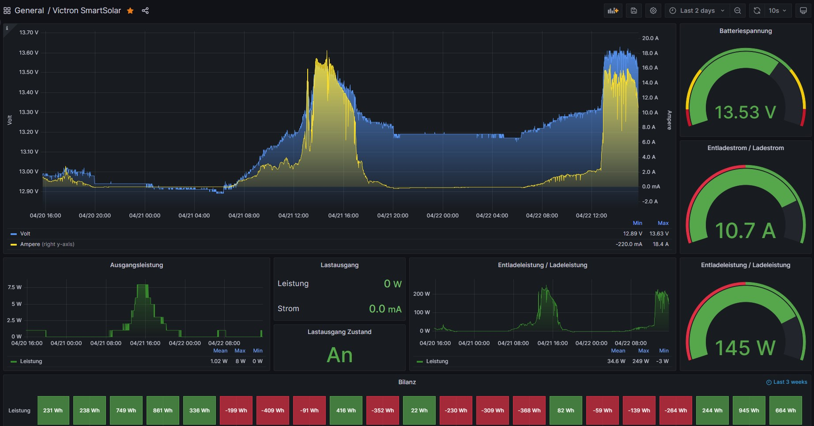
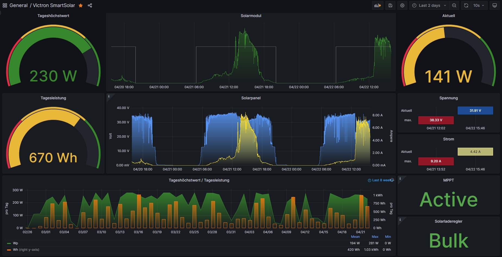
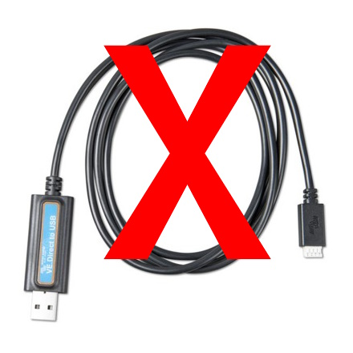
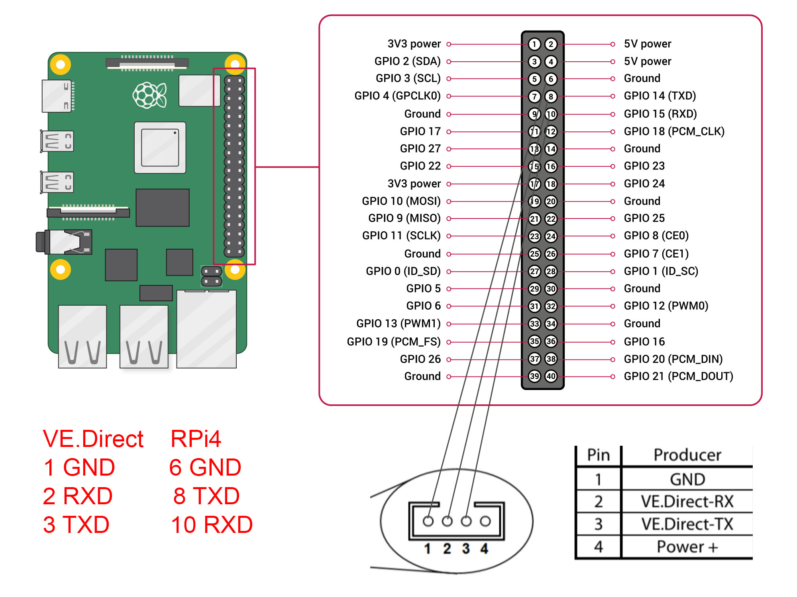

# Ve.Direct.InfluxDB.Collector

Ve.Direct.InfluxDB.Collector reads the Victron VE.Direct text protocol and writes metrics to InfluxDB 2.x or an Influx-compatible VictoriaMetrics endpoint. One process can monitor multiple VE.Direct devices.

<p align="center">
  <a href="https://sonarcloud.io/summary/new_code?id=DocBrown101_Ve.Direct.InfluxDB.Collector">
    
  </a>
</p>

<p align="center">
  <a href="https://sonarcloud.io/dashboard?id=DocBrown101_Ve.Direct.InfluxDB.Collector"></a>
  <a href="https://sonarcloud.io/dashboard?id=DocBrown101_Ve.Direct.InfluxDB.Collector"></a>
  <a href="https://sonarcloud.io/summary/new_code?id=DocBrown101_Ve.Direct.InfluxDB.Collector"></a>
</p>





## Requirements

- [Grafana](https://hub.docker.com/r/grafana/grafana) and [InfluxDB 2.x](https://hub.docker.com/_/influxdb/tags?page=1&name=2.7) or [VictoriaMetrics](https://hub.docker.com/r/victoriametrics/victoria-metrics)
- [Grafana dashboard](https://grafana.com/grafana/dashboards/14597)
- One or more Victron devices with a VE.Direct text-protocol connection
- A Raspberry Pi or another always-on computer with [.NET 10](https://dotnet.microsoft.com/en-us/download/dotnet/10.0)
- Permission to open the relevant serial devices





## Device Identity

Devices are identified by the VE.Direct `SER#` field. Port names are transport endpoints and may change after a reboot or USB reconnect without changing the time-series identity.

Every point contains these tags:

```text
host=<collector-host>
device=<VE.Direct SER#>
```

VictoriaMetrics converts Influx tags to labels, so `device` has the same meaning in both backends. Complete frame payloads from all devices share one bounded InfluxDB queue.

## InfluxDB Batching

InfluxDB writes run every ten seconds by default. Each request contains at most 100 complete frames. Frames received while a request is running remain in the queue for a later request.

Change the interval with `--influxWriteInterval`. The queue holds at most 2,000 complete frames by default; `--influxMaxQueuedFrames` changes that limit. If the queue is full, the oldest queued frame is discarded without blocking serial-port readers. A failed batch is retried unchanged at the next interval. Pending frames may be discarded when the application stops.

## Auto-Discovery

The collector polls `SerialPort.GetPortNames()` and starts an independent reader and parser for each port. The default scan interval is five seconds and can be changed with `--scan-interval`.

The application owns the port monitor and the selected frame output. Console output writes every accepted frame immediately. Influx output converts frames to metrics and passes them to its bounded background writer. During shutdown, the port monitor stops all readers before the output and its resources are disposed.

Automatic discovery is the only mode. The former `-p`/`--port` and `--auto-discover` options have been removed. The former time-based `-i`/`--interval` batch option has been replaced by event-based shared batching.

## Hotplug and Reconnect

- Each port has its own reader and parser state.
- New ports are opened during the next scan.
- Removed ports are stopped without affecting other readers.
- Open and read failures are isolated to the affected port and retried.
- After five seconds without incoming bytes, the reader releases its device identity and reconnects, even if the USB adapter is still plugged in.
- The parser discards frames larger than 4 KiB and resynchronizes on subsequent VE.Direct data.
- Shutdown stops all readers and then disposes the selected output.

Frames without a non-empty `SER#` are discarded. A warning is logged once per affected port until a valid serial number is received.

If two ports report the same `SER#`, the first reader remains active and the later source is suppressed. After the first reader disconnects, another port can take over that identity.

## Running the Collector

Run with InfluxDB output:

```bash
/path/to/Ve.Direct.InfluxDB.Collector \
  -o Influx \
  --influxDbUrl http://localhost:8086 \
  --influxDbBucket solar \
  --influxDbOrg home \
  --influxWriteInterval 10 \
  --influxMaxQueuedFrames 2000
```

To use a three-second discovery interval, add `--scan-interval 3`.

With two connected devices, startup output resembles:

```text
Monitoring serial port /dev/ttyUSB0.
Monitoring serial port /dev/ttyUSB1.
Detected VE.Direct device HQ123456 on /dev/ttyUSB0.
Detected VE.Direct device HQ987654 on /dev/ttyUSB1.
```

## Grafana Queries

Measurement and field names remain unchanged. For multiple devices, filter or group queries by the `device` tag.

InfluxDB Flux filter:

```flux
from(bucket: "solar")
  |> range(start: -24h)
  |> filter(fn: (r) => r._measurement == "ve_direct_battery")
  |> filter(fn: (r) => r.device == "HQ123456")
```

Flux grouping:

```flux
|> group(columns: ["device"])
```

VictoriaMetrics/PromQL:

```promql
ve_direct_battery_voltage{device="HQ123456"}
sum by (device) (ve_direct_panel_power)
```

## systemd

```ini
[Unit]
Description=VE.Direct metrics collector
After=network.target

[Service]
User=currentUser
Environment=DOTNET_ROOT=/home/currentUser/dotnet
Environment=PATH=/home/currentUser/dotnet
ExecStart=/home/currentUser/Ve.Direct.InfluxDB.Collector --influxDbBucket solar -o Influx
Restart=on-failure
RestartSec=5s

[Install]
WantedBy=multi-user.target
```
